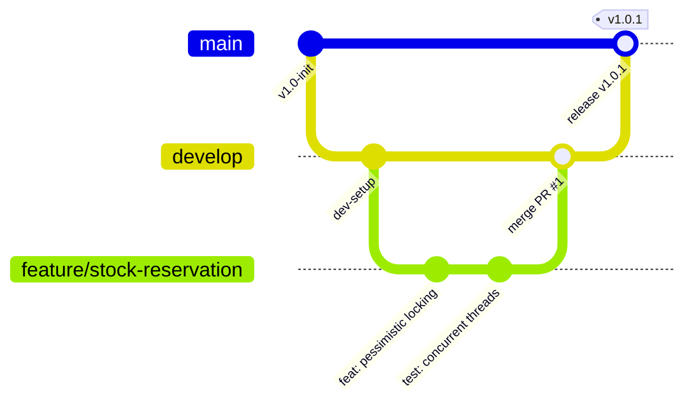

# ⚙️ Despacha Fácil — Backend API REST (Java 21 / Spring Boot 3)

> **Motor Transaccional y API REST Multi-Tenant para Despacha Fácil.**  
> Diseñado para ejecutar reservas atómicas de stock con concurrencia pesimista (`SELECT FOR UPDATE`), gestión de pedidos en tiempo real y aislamiento multi-tenant para el comercio digital en Perú y Latinoamérica.

---

## 👥 Equipo de Desarrollo

| Desarrollador | Usuario GitHub | Rol Principal |
| :--- | :--- | :--- |
| **Rommel Navarro** | [@Edudev2004](https://github.com/Edudev2004) | Lead Developer / Backend Architecture & DevOps |
| **Angella Pairazamán** | [@AngeDev-Ing](https://github.com/AngeDev-Ing) | Frontend Developer / Product Collaborator |

---

## 🛠️ Stack Tecnológico

* **Lenguaje & Plataforma:** Java 21 LTS (compatible con Java 23)
* **Framework:** Spring Boot 3.3.5 (Spring MVC, Spring Data JPA, Spring Security, Spring Validation, Spring Actuator)
* **Base de Datos:** PostgreSQL 16 Multi-Tenant (Shared Database, Shared Schema)
* **Migraciones de BD:** Flyway Database Migrations
* **Seguridad:** JWT (JSON Web Tokens) con algoritmo HMAC-SHA256 (`jjwt 0.12.6`) y contraseñas cifradas con BCrypt
* **Empaquetamiento:** Dockerfile Multi-Stage (Maven 3.9 + Eclipse Temurin 21 JRE Alpine)
* **Infraestructura:** VPS Ubuntu 24.04 LTS (Dokploy, Traefik Reverse Proxy, Cloudflare SSL/WAF)

---

## 🌿 Flujo de Trabajo GitFlow

El repositorio se rige por la metodología **GitFlow** para mantener una integración continua ordenada y libre de conflictos:



### 1. Definición de Ramas
* **`main`**: Rama de **producción**. Cada push a `main` dispara automáticamente el webhook de Dokploy que compila el contenedor Docker y lo publica en `https://api.despachafacil.com`. **Nunca hacer commits directos a `main`.**
* **`develop`**: Rama base de **desarrollo e integración**. Todo nuevo desarrollo converge aquí mediante Pull Requests (PRs).
* **`feature/<nombre>`**: Ramas temporales para implementar endpoints o servicios específicos (ej. `feature/auth-jwt`, `feature/atomic-order-service`).
* **`bugfix/<nombre>`**: Corrección de incidencias detectadas en `develop`.
* **`hotfix/<nombre>`**: Correcciones críticas de emergencia nacidas directamente de `main`.

### 2. Convención de Commits (Conventional Commits)
Se exige el uso de commits semánticos con la estructura: `<tipo>(<alcance>): <descripción>`
* `feat:` Nueva funcionalidad o endpoint (ej. `feat(orders): implement atomic stock reservation`).
* `fix:` Corrección de bugs o errores de lógica (ej. `fix(auth): fix tenant context injection in JWT filter`).
* `docs:` Documentación, READMEs o Swagger/OpenAPI.
* `refactor:` Optimización de código sin alterar el comportamiento de la API.
* `test:` Adición o mejora de pruebas unitarias/integración.
* `chore:` Actualizaciones de dependencias Maven, Dockerfile o plugins.

### 3. Proceso de Pull Request (PR)
1. Trae los últimos cambios: `git checkout develop && git pull origin develop`.
2. Crea tu rama: `git checkout -b feature/mi-feature`.
3. Desarrolla, testea y haz commits semánticos.
4. Sube tu rama: `git push -u origin feature/mi-feature`.
5. Abre el **Pull Request hacia `develop`** en GitHub para revisión y aprobación de código.

---

## 🏛️ Arquitectura del Sistema

### 1. Capas Lógicas
```text
[ Cliente Web / Móvil ] 
         │ (HTTP / JSON + Header X-Tenant-Slug / Bearer Token)
         ▼
[ Controller Layer ]     -> Validación de DTOs y mapeo HTTP REST
         │
         ▼
[ Security & Context ]   -> Inyección de TenantContext y validación JWT
         │
         ▼
[ Service Layer ]        -> Lógica de negocio (Reserva atómica, reglas de inventario)
         │
         ▼
[ Repository / DAO ]     -> Spring Data JPA con filtros obligatorios por tenant_id
         │
         ▼
[ PostgreSQL 16 ]        -> Bloqueo transaccional (SELECT ... FOR UPDATE)
```

### 2. Esquema de Base de Datos (14 Tablas Normalizadas)
El esquema implementa aislamiento multi-tenant estricto mediante la clave foránea e índice `tenant_id` gestionado por migraciones versionadas de **Flyway**:
1. `plans`: Planes del SaaS (Emprendedor, Pro, Ilimitado).
2. `tenants`: Registro de comercios con su subdominio `slug`, teléfono de WhatsApp, branding (`logo_url`, `primary_color`, `banner_url`), billeteras digitales (`yape_qr_url`, `yape_phone`, `plin_phone`) y regla global de envío gratis (`free_shipping_threshold`).
3. `shipping_rates`: Tarifario base configurable por zonas y modalidades (ej. Lima Centro, InDrive, Shalom Provincias). *(Añadido en V2)*.
4. `roles`: Roles del sistema (`ROLE_ADMIN`, `ROLE_OPERATOR`, `ROLE_DISPATCHER`).
5. `users`: Personal del comercio con autenticación JWT y asignación a tenant.
6. `categories`: Clasificación del catálogo con slug único por comercio.
7. `products`: Producto padre con badges promocionales (`badge`), flag de delivery gratis (`has_free_shipping`) y ordenamiento visual (`sort_order`).
8. `product_images`: Galería de fotos por prenda con ordenamiento para carruseles móviles. *(Añadido en V2)*.
9. `product_variants`: Variantes con SKU, precio regular, precio de oferta tachado (`compare_at_price`), costo y stock materializado (objetivo de bloqueo pesimista).
10. `inventory_movements`: Kardex automático e inmutable con tipos de movimiento, costo unitario (`unit_cost`) y motivo obligatorio.
11. `customers`: Registro de clientes compradores (Guest Checkout automático).
12. `orders`: Pedidos de venta con reserva atómica de 20 min (`expires_at`), fecha de aprobación (`paid_at`), canal (`channel: WEB_CATALOG / POS_MANUAL`) y método de pago (Yape/Plin/Transferencia).
13. `order_items`: Detalle de productos con snapshot histórico de nombres/precios y checklist de empaque (`is_packed`).
14. `dispatches`: Tablero logístico de despachos multimodal (`dispatch_type: COURIER / AGENCY / MOTORIZED`), clave de recojo para agencias (`pickup_code` para Shalom), agencia de destino y tracking.

#### Migraciones Flyway
* `V1__init_schema.sql`: Estructura inicial multi-tenant (12 tablas base, planes y roles).
* `V2__mvp_features_alignment.sql`: Alineación funcional con especificación MVP v1.0 (Tarifarios, galería, 20 min de reserva atómica, agencias Shalom/Olva y merchandising).

---

## 🚀 Puesta en Marcha Local

### Prerrequisitos
* Java 21 LTS o superior
* Maven 3.9+
* PostgreSQL 16 (local o mediante el túnel SSH al VPS)

### Configuración de Variables de Entorno
Crea tu archivo `.env` en la raíz del backend basándote en la plantilla [`.env.example`](.env.example):

```bash
# Conexión local a la base de datos (con túnel SSH en puerto 5433)
SPRING_DATASOURCE_URL=jdbc:postgresql://localhost:5433/despachafacil
SPRING_DATASOURCE_USERNAME=postgres
SPRING_DATASOURCE_PASSWORD=tu_contraseña_aqui

# Puerto de la API
PORT=8080

# Seguridad JWT (Cadena de 256 bits)
JWT_SECRET=tu_clave_secreta_jwt_de_256_bits
JWT_EXPIRATION_MS=86400000

SPRING_PROFILES_ACTIVE=local
```

### Compilación y Ejecución

```bash
# Compilar el proyecto con Maven
mvn clean package -DskipTests

# Ejecutar la aplicación Spring Boot
mvn spring-boot:run
```

La API responderá en [http://localhost:8080](http://localhost:8080).  
El health check estará disponible en [http://localhost:8080/actuator/health](http://localhost:8080/actuator/health).

---

## 🚢 Despliegue en Producción (Dokploy & Docker)

El despliegue está 100% automatizado mediante Dokploy:
1. Al realizar `git push origin main`, Dokploy detecta los cambios mediante el Webhook de GitHub.
2. Ejecuta el archivo [`Dockerfile`](Dockerfile) multi-stage:
   * **Stage 1 (Builder):** Descarga dependencias y compila el `.jar` con Maven.
   * **Stage 2 (Runtime):** Genera una imagen ligera sobre `eclipse-temurin:21-jre-alpine` con usuario sin privilegios (`appuser`).
3. Dokploy levanta el contenedor en la red interna de Docker comunicándose con PostgreSQL y expone la API de forma segura detrás de Traefik y Cloudflare en `https://api.despachafacil.com`.
